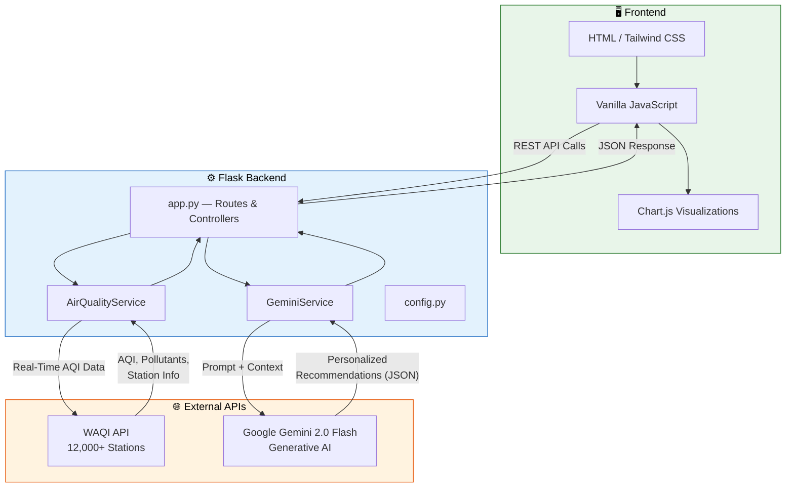

<p align="center">
  
  
  
  
  
  
  
  
</p>

<h1 align="center">🌿 UrbanAir — AI-Powered Urban Air Quality Assistant</h1>

<p align="center">
  <strong>Breathe smarter. Live healthier.</strong><br>
  Real-time air quality monitoring with AI-powered, profile-based health recommendations — built for <em>PromptWars Challenge-6</em> by <em>Hack2skill</em>.
</p>

---

## 📋 Table of Contents

- [🎯 Problem Statement](#-problem-statement)
- [✨ Features](#-features)
- [🏗️ Architecture](#️-architecture)
- [🛠️ Tech Stack](#️-tech-stack)
- [🚀 Getting Started](#-getting-started)
- [📸 Screenshots](#-screenshots)
- [🔌 API Endpoints](#-api-endpoints)
- [🌐 Deployment](#-deployment)
- [📁 Project Structure](#-project-structure)
- [🧪 Testing & Quality](#-testing--quality)
- [🔬 How It Works](#-how-it-works)
- [🔒 Security](#-security)
- [🤝 Contributing](#-contributing)
- [📄 License](#-license)
- [🙏 Acknowledgements](#-acknowledgements)

---

## 🎯 Problem Statement

Urban air pollution is one of the most pressing public health crises of our time. Every winter, cities across India and the developing world disappear under blankets of toxic smog — and **millions of people have no idea how to protect themselves**.

| The Challenge | The Reality |
|---|---|
| 🏭 **9 out of 10** people breathe polluted air (WHO) | Generic advisories like "stay indoors" aren't actionable |
| 💀 **6.7 million** premature deaths/year linked to air pollution | Different people face different risks — a toddler ≠ an athlete ≠ a pregnant mother |
| 🌫️ Winter AQI in Delhi regularly exceeds **400+** (Hazardous) | Existing tools show numbers, not **what to do about them** |
| 📉 Lack of **personalized, real-time** guidance | Communities need advice tailored to their lifestyle and health profile |

**UrbanAir bridges this gap** by combining real-time air quality data with the intelligence of Google Gemini to deliver **personalized, actionable health recommendations** — not just numbers, but a plan for your day.

> Built for **PromptWars Challenge-6** by **Hack2skill** — leveraging the power of generative AI to solve real-world environmental health challenges.

---

## ✨ Features

| Feature | Description |
|---|---|
| 🌍 **Real-Time AQI Monitoring** | Live Air Quality Index data from 12,000+ monitoring stations worldwide via the WAQI API |
| 🤖 **AI-Powered Recommendations** | Google Gemini 2.0 Flash generates personalized health guidance based on current conditions |
| 👨‍👩‍👧‍👦 **6 User Profiles** | Tailored advice for families, professionals, elderly, students, fitness enthusiasts, and expecting mothers |
| 📊 **Interactive Dashboard** | Beautiful AQI gauge, pollutant breakdown charts, and category indicators |
| 🏃 **Low-Emission Routines** | Daily schedule suggestions that minimize your exposure and carbon footprint |
| 🏠 **Indoor Air Quality Hacks** | Practical, budget-friendly tips to improve the air you breathe at home |
| 🌱 **Sustainable Alternatives** | Eco-friendly lifestyle swaps with quantified environmental impact |
| 📍 **Geolocation Support** | Auto-detect your location or search for any city/station globally |
| 📱 **Fully Responsive** | Pixel-perfect experience on mobile, tablet, and desktop |
| ⚡ **100% Real-Time** | No static datasets — every data point is fetched live from monitoring stations |

---

## 🏗️ Architecture



### Data Flow

1. **User Input** → User enters a city name or grants geolocation access
2. **AQI Fetch** → Backend queries the WAQI API for real-time air quality data
3. **Data Processing** → AQI values are categorized, pollutants are normalized, health implications are determined
4. **Profile Selection** → User selects their demographic profile (e.g., "Family with Children")
5. **AI Generation** → AQI data + user profile are sent to Google Gemini with a structured prompt
6. **Recommendation Delivery** → Gemini returns personalized JSON with routines, hacks, and alternatives
7. **Frontend Rendering** → Results are displayed with interactive charts, animated gauges, and categorized cards

---

## 🛠️ Tech Stack

| Layer | Technology | Purpose |
|---|---|---|
| **Backend** |  | Core application logic |
| **Framework** |  | Lightweight web framework with REST API |
| **AI Engine** |  | Generative AI for personalized recommendations |
| **Air Quality Data** |  | Real-time AQI from 12,000+ global stations |
| **Styling** |  | Utility-first CSS framework |
| **Charts** |  | Interactive pollutant visualizations |
| **Frontend** |  | Client-side interactivity (no frameworks) |
| **Deployment** |  | Production WSGI server |

---

## 🚀 Getting Started

### Prerequisites

| Requirement | How to Get It |
|---|---|
| **Python 3.10+** | [python.org/downloads](https://www.python.org/downloads/) |
| **WAQI API Token** | Free at [aqicn.org/data-platform/token](https://aqicn.org/data-platform/token/) |
| **Google Gemini API Key** | Free at [aistudio.google.com/app/apikey](https://aistudio.google.com/app/apikey) |

### Installation

```bash
# 1. Clone the repository
git clone https://github.com/yourusername/Urban_Air_Quality_Assistant.git
cd Urban_Air_Quality_Assistant

# 2. Create and activate a virtual environment
python3 -m venv venv
source venv/bin/activate        # Linux/macOS
# venv\Scripts\activate          # Windows

# 3. Install dependencies
pip install -r requirements.txt

# 4. Configure environment variables
cp .env.example .env
# Edit .env with your API keys:
#   GEMINI_API_KEY=your_gemini_api_key_here
#   WAQI_API_TOKEN=your_waqi_api_token_here
#   FLASK_SECRET_KEY=your_random_secret_key

# 5. Start the application
python app.py
```

🎉 **Open [http://localhost:5000](http://localhost:5000) in your browser and start exploring!**

---

## 📸 Screenshots

<!-- 
  Add screenshots of the application here. Recommended screenshots:
  
  1. Landing page / Hero section
  2. AQI Dashboard with gauge and pollutant charts
  3. User profile selection cards
  4. AI-generated recommendations view
  5. Mobile responsive view

  Example:
  
  
  
-->

> 📷 *Screenshots will be added after the application UI is finalized.*

---

## 🔌 API Endpoints

### `GET /api/health`

Health check endpoint.

**Response:**
```json
{
  "status": "ok"
}
```

---

### `POST /api/air-quality`

Fetch real-time air quality data for a location.

**Request (by city):**
```json
{
  "city": "Delhi"
}
```

**Request (by coordinates):**
```json
{
  "lat": 28.6139,
  "lng": 77.2090
}
```

**Response:**
```json
{
  "success": true,
  "data": {
    "aqi": 187,
    "station_name": "US Embassy, Delhi",
    "city": "Delhi",
    "dominant_pollutant": "pm25",
    "pollutants": {
      "pm25": 187,
      "pm10": 142,
      "o3": 12,
      "no2": 38,
      "so2": 8,
      "co": 15
    },
    "time_updated": "2026-11-20T12:00:00+05:30",
    "coordinates": {
      "lat": 28.6353,
      "lng": 77.2250
    },
    "category": {
      "level": "Unhealthy",
      "color": "#FF0000",
      "health_message": "Everyone may begin to experience health effects..."
    }
  }
}
```

---

### `POST /api/recommendations`

Get AI-powered personalized recommendations.

**Request:**
```json
{
  "city": "Delhi",
  "profile": "family_with_children"
}
```

**Supported Profiles:**
| Profile Key | Description |
|---|---|
| `family_with_children` | Families with young kids |
| `working_professional` | Office commuters |
| `elderly` | Senior citizens (60+) |
| `student` | School & college students |
| `fitness_enthusiast` | Runners, cyclists, gym-goers |
| `pregnant_woman` | Expecting mothers |

**Response:**
```json
{
  "success": true,
  "data": {
    "aqi_data": { "..." },
    "recommendations": {
      "aqi_summary": "Air quality in Delhi is currently Unhealthy...",
      "health_risk_level": "high",
      "low_emission_routines": [
        {
          "title": "Morning Indoor Yoga",
          "description": "Replace outdoor jog with indoor yoga session...",
          "impact": "Reduces PM2.5 exposure by 80% compared to outdoor exercise",
          "time_of_day": "morning",
          "icon": "🧘"
        }
      ],
      "indoor_air_quality_hacks": [
        {
          "title": "DIY Box Fan Filter",
          "description": "Attach a MERV-13 filter to a box fan...",
          "effectiveness": "High",
          "cost": "Low",
          "icon": "🌬️"
        }
      ],
      "sustainable_alternatives": [
        {
          "title": "Metro Over Car",
          "current_practice": "Driving personal car to work",
          "alternative": "Use Delhi Metro for daily commute",
          "environmental_impact": "Saves ~2.3 kg CO2 per trip",
          "icon": "🚇"
        }
      ],
      "immediate_actions": [
        "Close all windows and doors",
        "Run air purifiers on highest setting",
        "Wear N95 mask if going outside"
      ],
      "outdoor_activity_windows": "Early morning (6-8 AM) has the lowest AQI...",
      "weekly_wellness_tips": [
        "Include anti-inflammatory foods like turmeric and ginger",
        "Stay hydrated — drink 8-10 glasses of water daily"
      ]
    }
  }
}
```

---

### `GET /api/search-stations`

Search for air quality monitoring stations.

**Request:**
```
GET /api/search-stations?keyword=mumbai
```

**Response:**
```json
{
  "success": true,
  "data": [
    {
      "name": "Bandra, Mumbai, India",
      "aqi": 95,
      "station_id": "@8574",
      "coordinates": {
        "lat": 19.0596,
        "lng": 72.8295
      }
    }
  ]
}
```

---

## 🌐 Deployment

### Deploy to Render

1. Push your code to GitHub
2. Create a new **Web Service** on [render.com](https://render.com)
3. Connect your GitHub repository
4. Configure:
   - **Build Command:** `pip install -r requirements.txt`
   - **Start Command:** `gunicorn app:app`
5. Add environment variables (`GEMINI_API_KEY`, `WAQI_API_TOKEN`, `FLASK_SECRET_KEY`)
6. Deploy! 🚀

### Deploy to Railway

```bash
# Install Railway CLI
npm install -g @railway/cli

# Login and deploy
railway login
railway init
railway up
```

Add environment variables via the Railway dashboard.

### Deploy to Heroku

```bash
# Login to Heroku
heroku login

# Create app and deploy
heroku create urbanair-assistant
git push heroku main

# Set environment variables
heroku config:set GEMINI_API_KEY=your_key
heroku config:set WAQI_API_TOKEN=your_token
heroku config:set FLASK_SECRET_KEY=your_secret
```

> 💡 The included `Procfile` (`web: gunicorn app:app --bind 0.0.0.0:$PORT`) handles production server configuration automatically.

---

## 📁 Project Structure

```
Urban_Air_Quality_Assistant/
├── 📄 app.py                    # Flask application — routes & controllers
├── 📄 config.py                 # Configuration & environment variables
├── 📄 requirements.txt          # Python dependencies
├── 📄 .env.example              # Environment variable template
├── 📄 .gitignore                # Git ignore rules
├── 📄 Procfile                  # Production server configuration
├── 📄 README.md                 # Project documentation (you are here!)
│
├── 📂 services/
│   ├── 📄 __init__.py
│   ├── 📄 air_quality_service.py   # WAQI API integration & AQI processing
│   └── 📄 gemini_service.py        # Google Gemini AI integration
│
├── 📂 templates/
│   └── 📄 index.html            # Main HTML template (Tailwind CSS)
│
└── 📂 static/
    ├── 📂 css/
    │   └── 📄 styles.css        # Custom styles, animations & a11y support
    └── 📂 js/
        └── 📄 main.js           # Client-side logic & API interactions
│
└── 📂 tests/                    # Automated test suite (91%+ code coverage)
    ├── 📄 __init__.py
    ├── 📄 test_air_quality_service.py # Unit tests for WAQI API & calculations
    ├── 📄 test_gemini_service.py      # Unit tests for Gemini prompt & JSON parser
    ├── 📄 test_routes.py              # Integration tests for all Flask API endpoints
    └── 📄 test_config.py              # Unit tests for configuration management
```

---

## 🧪 Testing & Quality

UrbanAir is backed by an automated test suite achieving **91%+ test coverage** across all core services, route handlers, and configuration modules.

### Running Tests

Execute the test suite using **pytest** with code coverage reporting:

```bash
# Run pytest with coverage report
pytest --cov=services --cov=app --cov=config
```

Or run via Python's standard **unittest** discovery:

```bash
# Run standard unittest suite
python -m unittest discover tests
```

### Test Coverage Highlights

- **`test_air_quality_service.py`**: Validates AQI retrieval by city and GPS coordinates, error handling, station search keyword logic, all 6 AQI severity threshold bands (Good to Hazardous), and health advisory text.
- **`test_gemini_service.py`**: Verifies dynamic prompt construction across user profiles, markdown JSON fence stripping, invalid JSON fallbacks, and error handling.
- **`test_routes.py`**: Tests all REST endpoints (`/`, `/api/health`, `/api/air-quality`, `/api/recommendations`, `/api/search-stations`), input validation, missing parameters, and edge-case status codes.
- **`test_config.py`**: Verifies environment defaults, required keys, and safe fallbacks.

---

## 🔬 How It Works

```mermaid
flowchart LR
    A["🔍 Enter Location"] --> B["📡 Fetch Real-Time AQI"]
    B --> C["📊 Display Dashboard"]
    C --> D["👤 Select Profile"]
    D --> E["🤖 AI Generates Advice"]
    E --> F["💡 View Recommendations"]

    style A fill:#E8F5E9,stroke:#2E7D32,color:#000
    style B fill:#E3F2FD,stroke:#1565C0,color:#000
    style C fill:#FFF3E0,stroke:#E65100,color:#000
    style D fill:#F3E5F5,stroke:#7B1FA2,color:#000
    style E fill:#FCE4EC,stroke:#C62828,color:#000
    style F fill:#E0F7FA,stroke:#00695C,color:#000
```



### Step-by-Step Flow

| Step | Action | Details |
|:---:|---|---|
| **1** | 🔍 **Enter Location** | Type a city name (e.g., "Delhi") or click **"Use My Location"** to auto-detect via browser geolocation |
| **2** | 📡 **Real-Time AQI Fetch** | The backend queries the WAQI API for live data from the nearest monitoring station — AQI value, dominant pollutant, and individual pollutant concentrations (PM2.5, PM10, O₃, NO₂, SO₂, CO) |
| **3** | 📊 **Dashboard Visualization** | An animated AQI gauge displays the overall index, color-coded by severity. Chart.js renders pollutant breakdowns. Health implications are shown based on AQI category |
| **4** | 👤 **Select Your Profile** | Choose from 6 personas — each triggers a different AI prompt optimized for that demographic's specific health risks and lifestyle needs |
| **5** | 🤖 **AI-Powered Recommendations** | The AQI data + selected profile are sent to Google Gemini 2.0 Flash with a structured prompt. Gemini returns a comprehensive JSON payload with daily routines, indoor hacks, sustainable alternatives, and immediate actions |
| **6** | 💡 **Personalized Results** | Recommendations are rendered in categorized, visually rich cards — each with impact justifications explaining **why** the advice matters and **how much** difference it makes |

---

## 🔒 Security

| Measure | Implementation |
|---|---|
| 🔑 **Secret Management** | All API keys stored in `.env` environment variables — never committed to source control |
| 🛡️ **Input Validation** | Server-side validation and sanitization on all API inputs |
| 🌐 **CORS Configuration** | Flask-CORS configured to control cross-origin access |
| 🔐 **No Client-Side Secrets** | API keys are used server-side only — frontend never touches sensitive credentials |
| 📋 **`.gitignore` Protection** | `.env`, `__pycache__`, `venv/`, and other sensitive files excluded from version control |

---

## 🤝 Contributing

Contributions are welcome! Here's how to get involved:

1. **Fork** the repository
2. **Create** a feature branch
   ```bash
   git checkout -b feature/amazing-feature
   ```
3. **Commit** your changes
   ```bash
   git commit -m "feat: add amazing feature"
   ```
4. **Push** to the branch
   ```bash
   git push origin feature/amazing-feature
   ```
5. **Open** a Pull Request

### Contribution Guidelines

- Follow existing code style and conventions
- Write clear commit messages using [Conventional Commits](https://www.conventionalcommits.org/)
- Update documentation for any new features
- Test thoroughly before submitting a PR

---

## 📄 License

This project is licensed under the **MIT License** — see the [LICENSE](LICENSE) file for details.

```
MIT License

Copyright (c) 2026 UrbanAir

Permission is hereby granted, free of charge, to any person obtaining a copy
of this software and associated documentation files (the "Software"), to deal
in the Software without restriction, including without limitation the rights
to use, copy, modify, merge, publish, distribute, sublicense, and/or sell
copies of the Software, and to permit persons to whom the Software is
furnished to do so, subject to the following conditions:

The above copyright notice and this permission notice shall be included in all
copies or substantial portions of the Software.

THE SOFTWARE IS PROVIDED "AS IS", WITHOUT WARRANTY OF ANY KIND, EXPRESS OR
IMPLIED, INCLUDING BUT NOT LIMITED TO THE WARRANTIES OF MERCHANTABILITY,
FITNESS FOR A PARTICULAR PURPOSE AND NONINFRINGEMENT.
```

---

## 🙏 Acknowledgements

| Resource | Contribution |
|---|---|
| [**WAQI / AQICN**](https://aqicn.org/) | World Air Quality Index — real-time data from 12,000+ monitoring stations in 1,000+ cities |
| [**Google Gemini**](https://ai.google.dev/) | Generative AI powering personalized health recommendations |
| [**Hack2skill & PromptWars**](https://hack2skill.com/) | Organizing the PromptWars Challenge-6 hackathon |
| [**Central Pollution Control Board (CPCB)**](https://cpcb.nic.in/) | India's air quality monitoring infrastructure and standards |
| [**World Health Organization (WHO)**](https://www.who.int/) | Air quality guidelines and health impact data |
| [**Tailwind CSS**](https://tailwindcss.com/) | Utility-first CSS framework |
| [**Chart.js**](https://www.chartjs.org/) | Beautiful chart visualizations |

---

<p align="center">
  <strong>🌿 UrbanAir — Because the air you breathe should come with a plan.</strong>
  <br><br>
  Made with 💚 for cleaner cities and healthier lives.
  <br>
  <em>Built for PromptWars Challenge-6 by Hack2skill</em>
</p>
